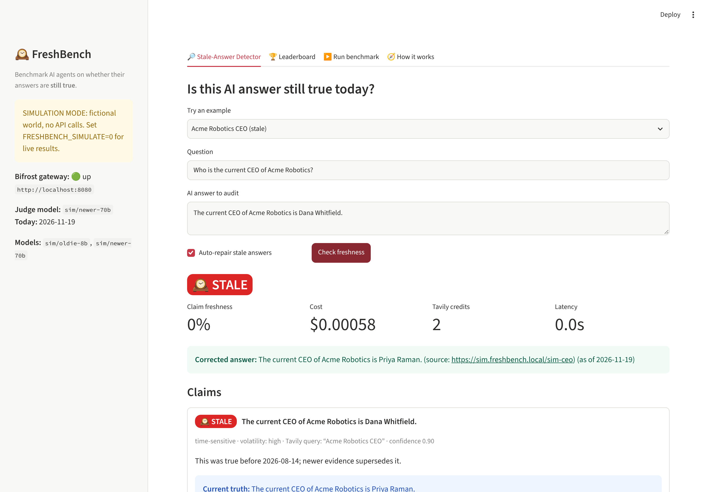
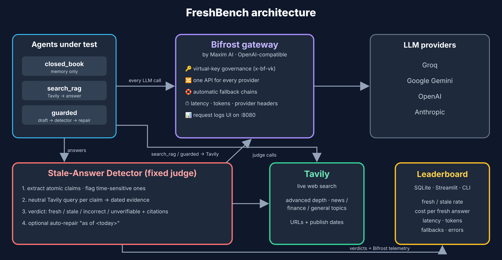

# 🕰️ FreshBench: benchmarking AI agents on whether their answers are *still true*

> **Bifrost track:** Build a Benchmarking Platform for AI Agents, Not Just Models
> **Tavily track (merged):** Stale-Answer Detector

LLM agents confidently repeat facts that **used to be true**: last year's champion, a former CEO, an old
library version, last quarter's interest rate. Most benchmarks can't catch this, because their gold answers are
frozen when the benchmark is written. **FreshBench has no frozen answers.** Every agent answer is broken into claims,
each time-sensitive claim is checked against the live web through **Tavily**, and every LLM call (from the agents
under test and from the judge) goes through the **Bifrost** gateway. That lets FreshBench measure an *agent*: its
freshness, but also its cost, latency, tokens, provider fallbacks and failures.



---

## What's inside

| Component | What it does |
|---|---|
| **Stale-Answer Detector** (`freshbench/detector.py`) | Extracts atomic claims, flags the time-sensitive ones, turns each into a *neutral* Tavily query (it never presupposes the claimed value), and judges it **fresh / stale / incorrect / unverifiable** against dated evidence with citations. It can optionally **auto-repair** the answer with an "as of" date. Usable as a standalone guardrail. |
| **Agents under test** (`freshbench/agents.py`) | `closed_book` (model memory only), `search_rag` (Tavily, then answer), `guarded` (closed-book draft, then the detector, then a repair). The same model goes into different agent designs, which is what makes this an agent benchmark rather than a model benchmark. |
| **Bifrost gateway client** (`freshbench/gateway.py`) | One OpenAI-compatible endpoint for Groq / Gemini / OpenAI / Anthropic. It sends a governance **virtual key**, can use automatic **fallback chains**, and records the provider actually used, the resolved model, gateway and upstream latency, tokens and cost for every call. |
| **Benchmark runner** (`freshbench/runner.py`) | Runs agents × models × tasks in parallel. A **fixed judge** (the same detector and model for everyone) scores every answer, and results go to SQLite. |
| **Leaderboard** (`freshbench/metrics.py`, `app.py`) | Fresh rate, stale rate, cost per *fresh* answer, latency, tokens, fallbacks, error rate and a single FreshScore. Streamlit dashboard with charts and per-question drill-down. |
| **Task set** (`data/tasks.json`) | 30 questions whose answers change over time (software versions, AI models, office holders, sports champions, awards, interest rates, market caps), plus an evergreen control. |
| **Calibration set** (`data/calibration.json`) | 15 labelled answers (known-stale plus evergreen controls) to measure the detector's own precision and recall: `python -m freshbench calibrate`. |
| **Simulation mode** | An offline, fictional world that exercises the whole pipeline without API keys (for tests, CI and demos). It is always clearly labelled as simulated. |

## How Bifrost and Tavily each contribute

**Bifrost (Maxim AI)** is the backbone of the *agent* part of the benchmark:
- **One API for every provider.** Agents and the judge just say `groq/llama-3.3-70b-versatile` or `openai/gpt-4o-mini`. Adding a model to the benchmark is a single line.
- **Governance.** `python -m freshbench bifrost-config` creates a **virtual key** (`x-bf-vk`) that restricts FreshBench to approved providers and models. Requests without it are rejected (HTTP 401).
- **Reliability.** Fallback chains (`--fallbacks gemini/gemini-2.5-flash`) are handled by Bifrost. FreshBench reads Bifrost's routing headers and counts how often each agent needed a fallback.
- **Telemetry.** The provider actually used, the resolved model, `x-bifrost-latency-ms` / `x-bifrost-upstream-latency-ms` and token usage feed the cost and latency columns of the leaderboard. You can also browse every request in the Bifrost UI at `http://localhost:8080`.

**Tavily** is the source of *current truth*:
- The detector sends one **advanced** search per time-sensitive claim (`topic` = news / finance / general) and keeps URLs and **publish dates**, so the judge can prefer the newest evidence.
- The `search_rag` agent and the `guarded` agent's repair step use Tavily to ground their answers.
- Tavily credits count toward each agent's cost (the *cost per fresh answer* metric), and results are cached for 6 hours so agents in the same run don't pay twice for the same query.

## Architecture



```
 Agents under test ──► Bifrost gateway ──► Groq · Gemini · OpenAI · Anthropic
   closed_book            │ virtual key governance · fallbacks · latency/tokens/cost headers
   search_rag ──► Tavily  │
   guarded ──► Detector   │
          │               ▼
          └──► Stale-Answer Detector (fixed judge, via Bifrost)
                 1. claim extraction + time-sensitivity
                 2. neutral Tavily query per claim → dated evidence
                 3. verdict fresh / stale / incorrect / unverifiable + citations
                 4. optional auto-repair "as of <today>"
          ▼
   SQLite ──► Leaderboard (Streamlit) · CLI
```

## Installation

**Requirements:** Python 3.10+, Docker, a free [Tavily key](https://app.tavily.com), and at least one LLM key
(Groq and Gemini both have free tiers).

```bash
git clone https://github.com/<you>/freshbench.git && cd freshbench
python -m venv .venv && source .venv/bin/activate      # Windows: .venv\Scripts\activate
pip install -r requirements.txt
cp .env.example .env                                     # add TAVILY_API_KEY and e.g. GROQ_API_KEY
python -m freshbench bifrost-config                      # writes bifrost/config.json (providers + virtual key)
docker compose up -d                                     # starts Bifrost on http://localhost:8080
python -m freshbench doctor                              # checks keys, models and gateway
```

## Usage

```bash
# Audit a single answer (Stale-Answer Detector)
python -m freshbench check "Which country won the most recent FIFA World Cup?" \
  "Argentina won the most recent FIFA World Cup, beating France in the 2022 final."

# Run the benchmark (agents x models x tasks), then print the leaderboard
python -m freshbench run --agents closed_book search_rag guarded \
  --models groq/llama-3.1-8b-instant groq/llama-3.3-70b-versatile --limit 10 \
  --fallbacks gemini/gemini-2.5-flash

python -m freshbench leaderboard
python -m freshbench calibrate            # detector precision/recall on labelled answers

streamlit run app.py                      # dashboard: detector, leaderboard, run benchmarks
```

**No keys yet?** Try everything offline: `FRESHBENCH_SIMULATE=1 streamlit run app.py` (fictional world, no API calls).

## Metrics

| Metric | Definition |
|---|---|
| **Fresh rate** | Share of answers to time-sensitive questions whose time-sensitive claims are all verified current today |
| **Stale rate** | Share of answers containing at least one stale or incorrect claim |
| **Unverified rate** | Share the judge could not verify either way (reported, never hidden) |
| **Cost per fresh answer** | (LLM cost reported or estimated through Bifrost + Tavily credits × $0.008) ÷ number of fresh answers |
| **Latency / tokens** | Per agent run, summed over all of the agent's LLM calls |
| **Fallbacks / error rate** | How often Bifrost had to fail over, and how often the agent failed outright |
| **FreshScore** | `100 × fresh_rate × (1 − error_rate) − 50 × stale_rate` (stale answers are penalised, not just missed) |

The judge's own cost is tracked separately and **not** charged to the agents.

## Testing

```bash
pytest -q                                                    # unit + full simulated benchmark
FRESHBENCH_BIFROST_TEST_MODEL=groq/llama-3.1-8b-instant pytest tests/test_bifrost_live.py   # live gateway
```

During development the whole benchmark (48 agent runs: 3 agents × 2 models × 8 tasks) was also run through a **real
Bifrost container** (`maximhq/bifrost`), using the config generated by `bifrost-config`. That run included virtual-key
enforcement and an automatic OpenAI→Groq fallback, and finished with 0 errors.

## Implementation notes and design decisions
- **Neutral queries.** For "Rishi Sunak is UK PM", the detector searches "current UK prime minister", not "Rishi Sunak prime minister". This avoids confirmation bias in retrieval.
- **Stale vs incorrect.** "Was true and has been superseded" (the typical LLM failure) is kept separate from "never true" (a hallucination).
- **Fixed judge.** The same judge model scores every agent, so comparisons are fair. Change it with `FRESHBENCH_JUDGE_MODEL`.
- **No gold answers, so the benchmark doesn't rot.** Run it next month and the expected truths update by themselves.
- **Evergreen controls** check that the detector doesn't flag facts that can't change.

## Limitations
- The judge is an LLM, so its verdicts can be wrong. That's why `calibrate` and the `unverifiable` verdict exist.
- Tavily results reflect the open web. Breaking news from the last few hours may be classified as `unverifiable`.
- Model prices in `freshbench/config.py` are approximate list prices, used only when Bifrost doesn't report a cost.

## Tech stack
Python 3 · **Bifrost** (Maxim AI LLM gateway, Docker) · **Tavily** Search API · Streamlit · Plotly · pandas · SQLite · pytest

## Project layout
```
freshbench/  gateway.py  search.py  detector.py  agents.py  runner.py  metrics.py  store.py  sim.py  bifrost_config.py  __main__.py
app.py       Streamlit dashboard
data/        tasks.json  calibration.json  sim_tasks.json
docs/        screenshots, architecture, pitch deck, demo script
tests/       unit + simulated end-to-end + live Bifrost test
```

## License
MIT
